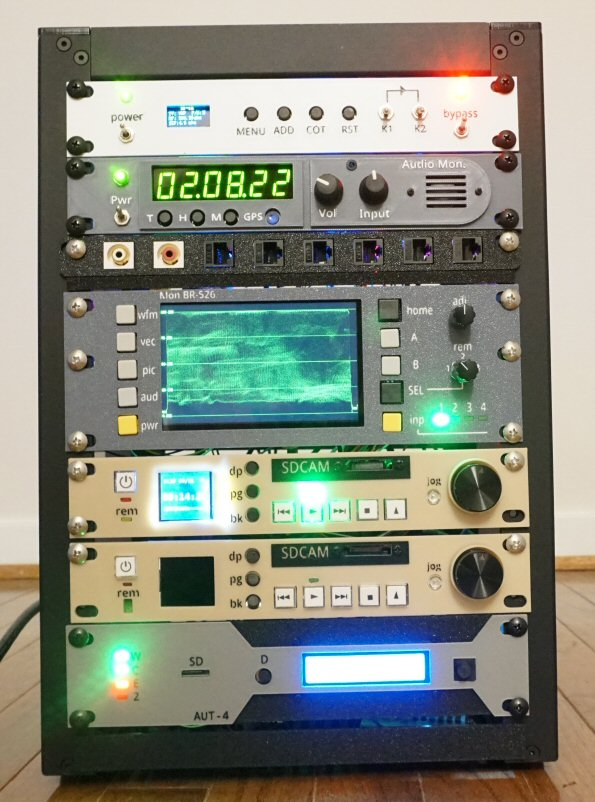

# Homelab Pi-Powered TV Master Control
A standard-def homelab rack mounted TV master control all made out of Raspberry Pis and Picos, inspired by 1990s equipment.

This repo is a work in progress; all files are not yet posted and progress will depend on interest. Add a comment/issue if you are looking for a particular resource.

Most of the STL files and basic code are available in the folders above.
