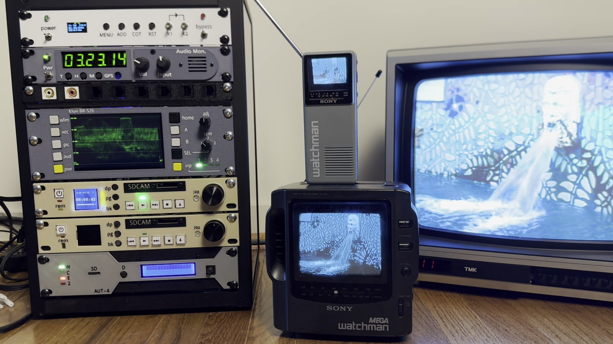

# Homelab Pi-Powered TV Master Control
A standard-def homelab rack mounted TV master control all made out of Raspberry Pis and Picos, inspired by 1990s equipment. [See the full video here](https://youtu.be/dvhU6qKurbk?si=hsHPz8lPBxtPz9eP).

Each folder above is for a different item in the rack. So far, most of the STL files for the faceplates have been added, as well as the wavefom/vectorscope files. 

This repo will probably never be complete and is not necessarily intended to cover every aspect of the project. It's mainly for anyone interested to see how some of the equipment was made and some of the code that was used. (Think of it as a template for making your own similar project.) If you want to replicate this, a lot of tinkering will be required! Because I'm already on my next project, there may be little or no updates here or addressing of any issues.

