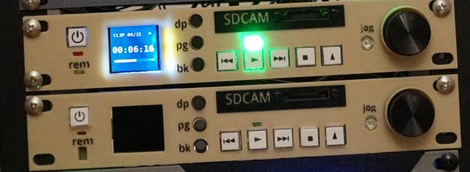

# SDCAM deck

The player is reminiscent of a VTR crossed with a modern XDCAM deck. It plays back videos from SD cards in standard definition. Include any mp4 files in the folder when building the Dockerfile to have them auto start playing in a loop when the player starts up. I included one as a test.

Computer: Pi 3b+

Display: https://www.adafruit.com/product/2088

OS: BalenaOS

Buttons: https://www.amazon.com/dp/B0B3RVGH88

Rotary encoder for jog/shuttle wheel: https://www.adafruit.com/product/5880

Add custom configuration: `BALENA_HOST_CONFIG_dtoverlay` = "spi0-0cs" for the display

