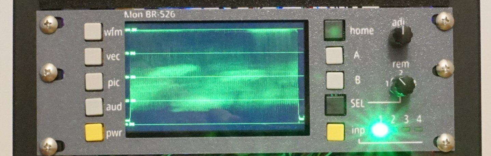

# Scope/audio/video monitor (Mon BR 526)

A waveform monitor, vectorscope, video monitor, and VU meter on a Raspberry Pi 5 and DSI touchscreen.



## About
This device uses containers to compartmentalize each operation. The scopes are displayed in a Chromium web browser courtesy of the [balena Browser Block](https://github.com/balenasolutions/browser) which is simply a container that accepts a URL and outputs the page to the screen. The pages are written in JavaScript and reside in HTML pages which are served up via an Express web server in the webserver container. The controller is a Python script that reads button presses and manipulates the browser block via its API.

## Parts List:

Touch screen: [ELECROW 5 Inch Touch Screen Monitor for Raspberry Pi 800×480 LCD Display](https://www.amazon.com/dp/B07FDYXPT7)

Tactile push buttons: [Adafruit assortment](https://www.adafruit.com/product/1010), and others

Video Capture: https://www.amazon.com/dp/B0CB6BW6X4 or equivalent - there appear to be many sold that use the same internal parts.

Your Pi 5 should have an active cooler if the scopes will be running long term.

## The build

More to follow, for now, [see the video](https://youtu.be/dvhU6qKurbk?si=hsHPz8lPBxtPz9eP&t=440).

## Setup
This device is designed to be used on [balenaOS](https://www.balena.io/) - you can set up a free account there and have up to 10 devices at no charge. Create a new fleet, add a device, and use the balenaCLI to push this as a new release to your device(s). More detailed instructions to follow eventually.

You could also run these on Docker for Raspberry Pi OS, but that is not covered here.

### Configuration in the balenaCloud dashboard
Define device GPU memory in megabytes. 128

Define DT overlays "vc4-kms-v3d,cma-320","gpio-shutdown,gpio_pin=5"

BALENA_HOST_CONFIG_dtoverlay "panel-ilitek-ili9881c"

## Pi 4 version

The code should work on a Pi 4 as well.

For a Pi 4, add a cheap fan using a bracket such as this: https://www.printables.com/model/328676-raspberry-pi-4-fan-mount-backward-compatible/files

Configuration settings for the Pi 4:
```
Device GPU memory in megabytes: 64
Define DT overlays: "vc4-kms-v3d,composite=1,cma-320","gpio-key,gpio=4,keycode=28,label=ENTER,gpio_pull=up,active_low=1","gpio-key,gpio=18,keycode=15,label=TAB,gpio_pull=up,active_low=1"
Custom configuration:
BALENA_HOST_CONFIG_enable_tvout: 1
BALENA_HOST_CONFIG_sdtv_mode: 0
```
